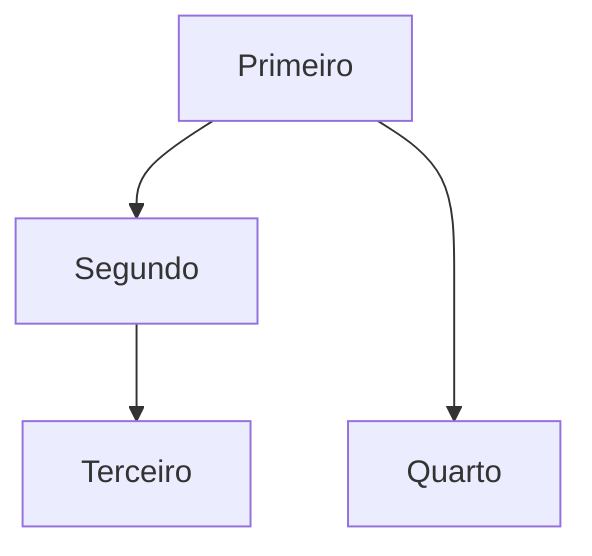

# Syntax traps, layout and styling on Mermaid 12

Read when `check-mermaid.mjs` reports an error you do not recognize, when a diagram lays out badly,
or before adding any style. Everything here was checked against Mermaid 12.2.0 — the parse cases
with `check-mermaid.mjs`, the silent misparses and the layout with the PNGs of
`render-mermaid.mjs` and the box positions measured in the same Chromium.

- [Parse errors](#parse-errors)
- [Silent misparses](#silent-misparses)
- [Layout under ELK](#layout-under-elk)
- [Styling that survives both themes](#styling-that-survives-both-themes)
- [Limits and text wrapping](#limits-and-text-wrapping)
- [When Mermaid changes version](#when-mermaid-changes-version)

## Parse errors

### Flowchart

| Written | Why it fails | Write instead |
|---|---|---|
| `a --> end` | `end` (lowercase) closes a subgraph | `fim["Fim"]` — inside a label it is fine |
| id `style`, `graph`, `meu no` | keyword, or a space in the id | ASCII camel/snake id + label |
| `flowchart td` | direction must be uppercase | `TD`, `TB`, `BT`, `LR`, `RL` |
| `a[Chama f(x)]`, `a[lista[0]]` | brackets/parentheses open a shape | `a["Chama f(x)"]` |
| `a[diz "oi"]` | inner quote | `a["diz #quot;oi#quot;"]` |
| `a[/api/projetos]` | `[/…/]` is the lean shape | `a["/api/projetos"]` |
| `a -->\|sim (ok)\| b` | parentheses in an edge label | `a -->\|"sim (ok)"\| b` |
| `a --> b %% nota` | comments only on their own line | move `%% nota` to its own line |
| `linkStyle 5 …` with fewer than 6 edges | index out of range (`a --> b & c` counts 2) | count edges, or avoid `linkStyle` |
| `a@{ shape: cilindro }` | unknown shape name | `cyl`, `rect`, `rounded`, `stadium`, `diam`, `fr-rect`, `doc` |
| `classDef x stroke:rgba(…)` | the `classDef` parser rejects `rgb()`, `rgba()` and `var(--…)` | a hex stroke (see *Styling*) |

Quoted labels accept `;`, `:`, `'`, `&`, `<`, `#`, `%`, `@`, `-->` and accents. Entity codes:
`#quot;`, `#35;` (`#`), `#59;` (`;`). Line break: ` `.

### Sequence

- A participant named `end` breaks the parse; alias it (`participant fim as end`).
- `;` inside a message breaks it; write `#59;`. A second `:` in the message is fine.
- An `alt`/`opt`/`loop`/`par`/`critical`/`break`/`rect` without its `end` breaks it.
- `deactivate x` without a matching activation throws "Trying to inactivate an inactive participant".

### State

- A hyphenated id (`em-revisao`) or a quoted id (`"Em revisão" --> ok`) breaks the parse:
  `state "Em revisão" as emRevisao`.
- Transition labels may contain `:` and parentheses.

### ER

- An inline alias in a relationship line (`u["Usuário"] ||--o{ p : …`) breaks the parse; declare the
  alias on its own line first.
- Attribute comments (`"…"`) cannot contain `"`, not even escaped. Keys: `PK`, `FK`, `UK`, combined
  `PK, FK`.

### Class

- `classDef`/`style` whose first property is hyphenated (`stroke-width`, `font-size`) breaks the
  parse; start with `stroke:`, `fill:` or `color:`. (In a flowchart, `classDef x stroke-width:3px`
  is fine.)
- An accented class name (`class Usuário`) parses on this version, but keep ids ASCII with the
  label in brackets (`class Usuario["Usuário"]`), as everywhere else.

### Any type

- Bad YAML indentation in the frontmatter breaks the parse.
- `accTitle`/`accDescr` break `mindmap`, `block` and `sankey` (with or without `-beta`).
- `architecture` needs the `-beta` suffix; `block` and `sankey` no longer do.

## Silent misparses

These parse, so `check-mermaid.mjs` reports `ok` — only the PNG shows them.

- `dev---ops` becomes `dev --o ps` (an edge ending in a circle, and a node `ps`), `a---xis` a cross
  edge: an edge glued to an id starting with `o` or `x`. Spaces around edges avoid it.
- Sequence `box #hex Nome`: `#` starts a comment — the box loses its color **and** its label.
- An unknown layout (`layout: nada`) falls back to dagre without a word; a misspelled config key
  (`layuot: dagre`) or an invalid value (`look: fancy`) is ignored.

## Layout under ELK

ELK is Mermaid 12's default layout for flowchart, state, class and ER; Mermaid bundles it, so the
site needs no extra package. Sequence, timeline and the chart types have their own fixed layouts.

- **Extra dashes do nothing**: `a ----> d` lays out exactly like `a --> d`. To line up a node with
  a later step, chain it after that step instead.
- **`flowchart.nodeSpacing` and `rankSpacing` do nothing.** ELK keeps about 40 px between boxes
  and between ranks whatever the frontmatter says. A diagram past the column needs splitting, not
  spacing.
- **Subgraph `direction`** is honored only when no edge links a node inside the subgraph to a node
  outside it. An edge to the subgraph's own id (`x --> grupo`) keeps it.
- **Invisible edge** `a ~~~ b` is a real edge for the layout, drawn invisible — usable to force
  order or stack subgraphs.
- **Declaration order** is the first thing to fix when the result looks shuffled: ELK follows the
  order nodes and edges are declared in, so declare in reading order before reaching for invisible
  edges.
- **Orthogonal edges.** ELK routes edges in right angles and may carry an edge out of its subgraph
  to reach a node placed below it; look at the PNG before deciding the picture reads well.

**`layout: dagre` as a last resort.** A diagram can ask for Mermaid 11's layout in its frontmatter.
Under dagre, extra dashes lengthen an edge again and the spacing options work (defaults 50 and 50,
wider than ELK's):

Each extra dash is one more rank: `--->` puts Quarto two ranks below Primeiro, beside Terceiro.

It is a layout choice, not styling — it does not pin a theme — but it makes that one diagram lay
out differently from every other on the site. Reach for it only when reordering, splitting and
invisible edges have failed, and say why in a `%%` comment on the line after the frontmatter.

## Styling that survives both themes

The page redraws the diagram with `default` (light) or `dark`. Only what comes from the theme
changes; everything written in the diagram stays identical in both modes. The classic failure:
`classDef x fill:#fde68a` — a bright block on the dark page, and, if the text color is not pinned
too, light text on a light fill.

In order of preference:

1. **No color** — shape, subgraph and line style carry the meaning (`-.->` async/optional, `==>`
   the main path). This is the default.
2. **Emphasis without fill:** `classDef destaque stroke-width:3px` or `stroke-dasharray:5 5`, then
   `class no1,no2 destaque` or `no1:::destaque`. Works in flowchart, state and ER.
3. **A mid-tone stroke** that reads on white and on near-black — `classDef erro
   stroke:#dc2626,stroke-width:2px` (red), `#2563eb` (blue), `#d97706` (amber), `#16a34a` (green).
   Always paired with something that is not color (a label, a line style): color alone never
   carries meaning.
4. **Sequence bands:** `rect rgba(127,127,127,0.12) … end` — grey with alpha reads on both
   backgrounds. Never `#hex` in `box`.

Never: `style` per node, a hex `fill`, frontmatter `theme`/`themeVariables`/`look`, `%%{init}%%`
(deprecated since 10.5, and it would pin the theme anyway).

## Limits and text wrapping

- `maxTextSize` 50 000 characters and `maxEdges` 500; past either, the diagram becomes an error box.
  A diagram near either limit is far past the size caps anyway.
- Flowchart labels wrap at spaces once they reach 120 px (`flowchart.wrappingWidth`), and the box
  is never narrower than the wrap plus 32 px of padding — 152 px, even for "A". A single word longer
  than the wrap widens its box ("Responsabilidadesinternacionais" makes a 279 px box). Raising
  `wrappingWidth` widens every box, so it costs columns instead of saving lines. Long Portuguese
  words do not hyphenate on their own, but an existing hyphen is a break point ("Serviço de
  e-mail" breaks after "e-") — use ` ` to choose the break.
- Sequence messages do not wrap unless prefixed with `wrap:`.
- Markdown strings — ``a["`**negrito** e *itálico*`"]`` — allow bold/italic and real newlines.

## When Mermaid changes version

`@docusaurus/theme-mermaid` accepts `mermaid >=11.6.0`, so the version comes from the lockfile:
this repository's first install resolved 12.2.0. Going from 11 to 12 changed three things measured
here: ELK became the default layout (and took away extra dashes and the spacing options), the
flowchart wrap went from 200 px to 120 px, and every box got the 152 px minimum width. The default
look is still `classic` on 12.2.0. After a lockfile update brings another version, run
`check-mermaid.mjs docs` and `render-mermaid.mjs` on every page with a diagram, measure again what
this file and the facts at the top of the SKILL.md state, and update both.
