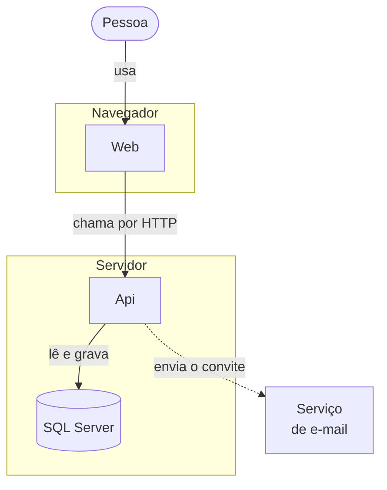
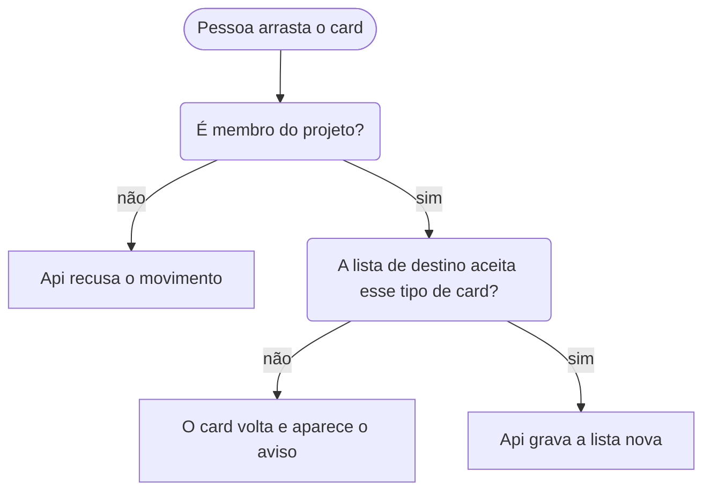
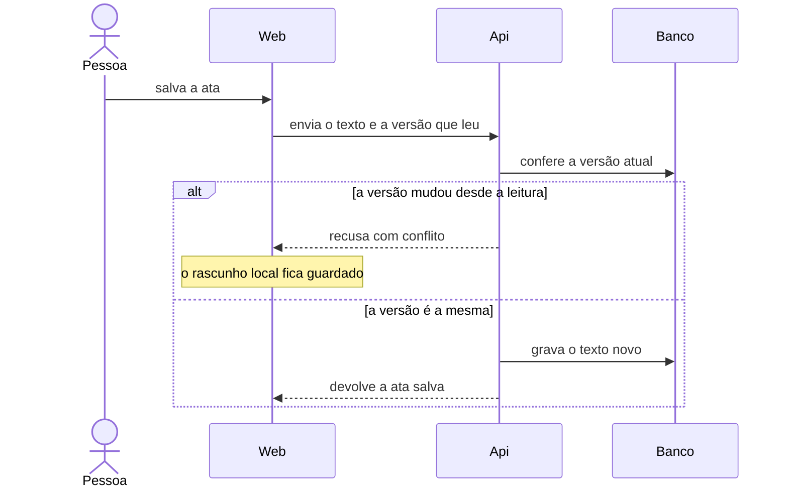
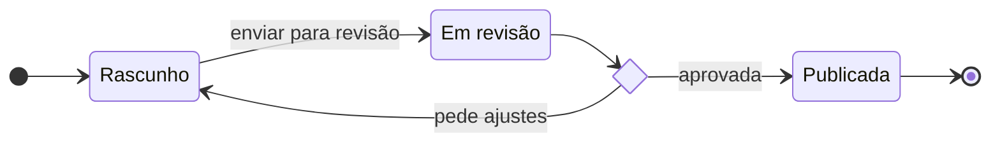
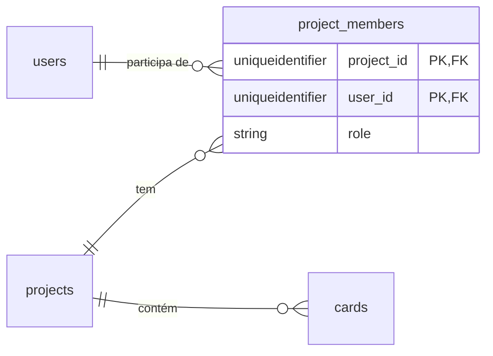
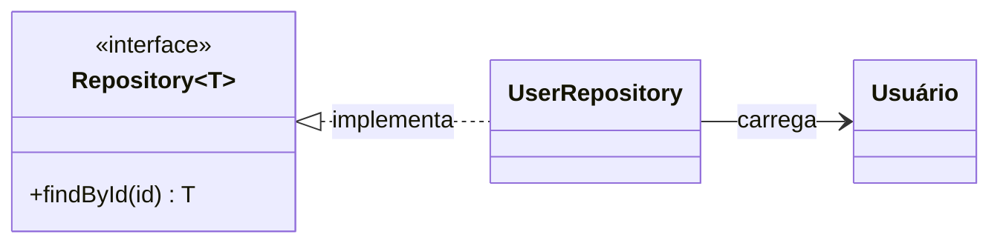
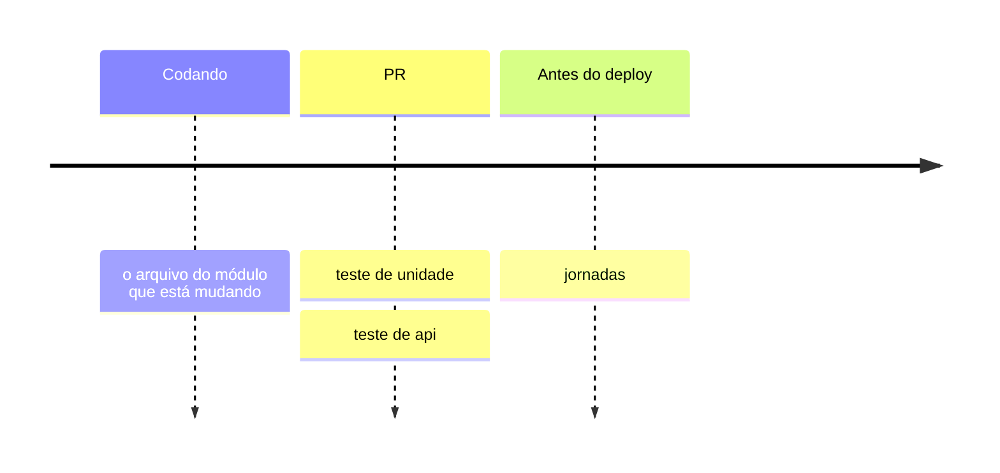
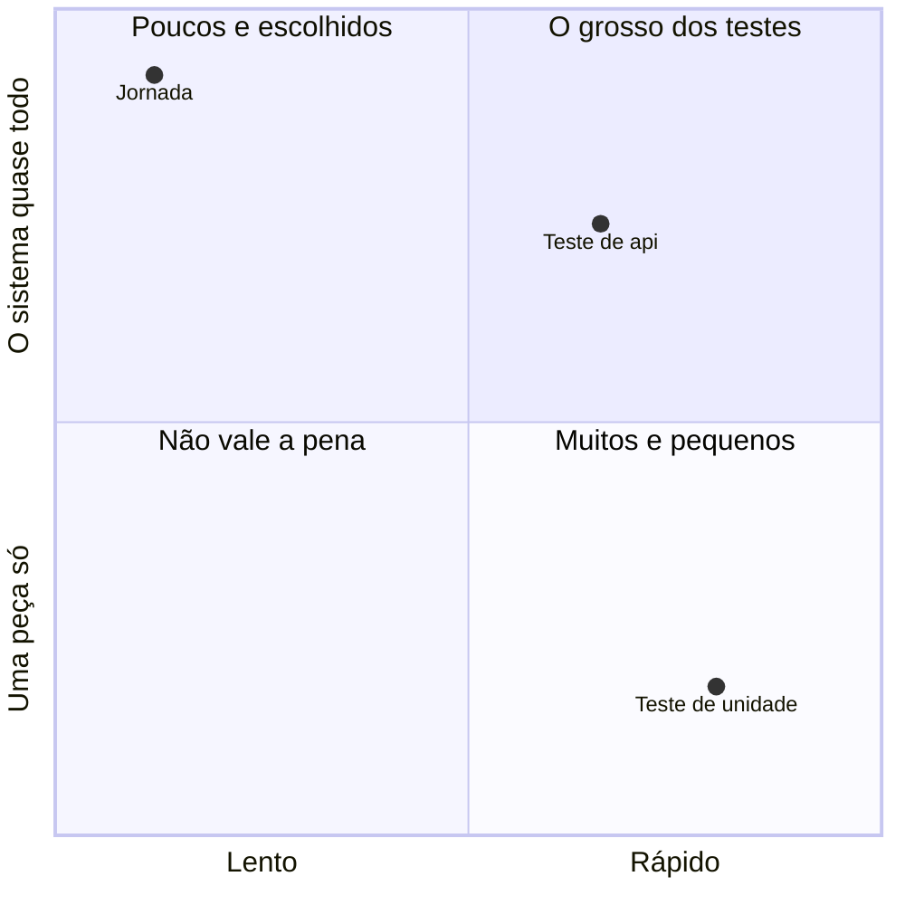

# Templates per diagram type

Starting points that follow the rules of the SKILL.md (ASCII ids, quoted pt-BR labels, decisions
in rounded boxes, `accTitle`, no color), pass `scripts/check-mermaid.mjs` and were looked at in
both themes with `scripts/render-mermaid.mjs`. Replace the domain, keep the shape. Names here are
illustrative — use the page's and the code's real names.

- [flowchart — parts and boundaries](#flowchart--parts-and-boundaries)
- [flowchart — decision](#flowchart--decision)
- [sequenceDiagram](#sequencediagram)
- [stateDiagram-v2](#statediagram-v2)
- [erDiagram](#erdiagram)
- [classDiagram](#classdiagram)
- [timeline and quadrantChart](#timeline-and-quadrantchart)
- [Types to avoid or use with care](#types-to-avoid-or-use-with-care)

## flowchart — parts and boundaries

One `subgraph` per boundary (where it runs, which app owns it); edges are the verbs between parts.
Keep edges that cross a subgraph few — each one makes the subgraph ignore its own `direction`.

## flowchart — decision

The question in a rounded box, `sim`/`não` on the edges, outcomes as plain nodes. Declare in reading
order.

## sequenceDiagram

One scenario. Participants declared up front with a short ASCII id and a pt-BR alias; `->>` request,
`-->>` response, `-)` fire-and-forget. One `alt` for the error path, or a second diagram.
Messages cannot contain `;` (write `#59;`).

Also available: `opt`, `loop`, `par … and … end`, `critical … option … end`, `break … end`,
`autonumber` (when the prose refers to steps by number), `wrap:` before a long message
(`api-->>web: wrap: texto longo`), `Note over a,b: …`.

## stateDiagram-v2

A state label with spaces or accents goes through `state "…" as id`; a hyphenated or quoted id breaks
the parse. `<<choice>>` for a branch that depends on a condition.

Composite states (`state publicada { … }`) exist; more than one level of nesting is past the size
cap.

## erDiagram

Use the real table names when documenting the database, and show only the columns the page talks
about — the full column list belongs in a table or in the code. Relationship labels in quotes. An
alias (`p["Projeto"]`) must be declared on its own line before being related, never inline in a
relationship.

Cardinality ends: `|o` zero or one, `||` exactly one, `}o` zero or more, `}|` one or more. `--` is an
identifying (solid) relation, `..` a non-identifying (dashed) one.

## classDiagram

Only for a real type relationship the prose needs (an interface and who implements it, an
inheritance). Keep the id ASCII and put the accented name in the label — `class Usuario["Usuário"]`.
In a `classDef` here, the first property must not be hyphenated (`stroke:` before `stroke-width:`).

## timeline and quadrantChart

Put the title in the page's heading or lead-in sentence, not in the chart — text inside the SVG is
not searchable.

In the prose, say the positions are judgment calls, not measurements. A point's label is centered
under it and is not kept inside the chart: past about 0.85 on the x axis a long label is cut at the
border. The timeline colors each section from the theme's palette, different in light and dark —
the colors never carry meaning there.

## Types to avoid or use with care

- **`C4Context` / `C4Container`** — experimental, lays out by statement order, fixed colors that
  ignore dark mode, no legend. Draw C4-style context/container views as a flowchart with subgraphs.
- **`architecture-beta`** — force-directed layout where siblings can overlap, only five built-in
  icons. Same answer: flowchart with subgraphs.
- **`mindmap`** — radial layout, hierarchy by relative indentation (`root((Texto))`). `accTitle`
  and `accDescr` break its parse; the lead-in sentence has to carry the title.
- **`block`** — a manual grid (`columns 3`, `a:2` to span) for stacked-layer pictures when a
  flowchart keeps reordering the layers. `accTitle` breaks its parse too.
- **`gantt`** — dates rot. Only for a plan whose dates are part of the decision being documented;
  add `todayMarker off` so the picture does not change every day.
- **Icons** (`@{ icon: "fa:…" }`, `fa:fa-x` in labels) need an icon pack the site does not
  register — they render as nothing.
