# Livro-Caixa

App Android para as contas de uma família: as contas do mês, quem pagou cada uma e o comprovante de
cada pagamento, vistos por todos em tempo real. Feito em Expo + React Native, com o Firebase como
back-end, sem servidor próprio.

<table>
  <tr>
    <td width="25%"><br><sub>O mês da família</sub></td>
    <td width="25%">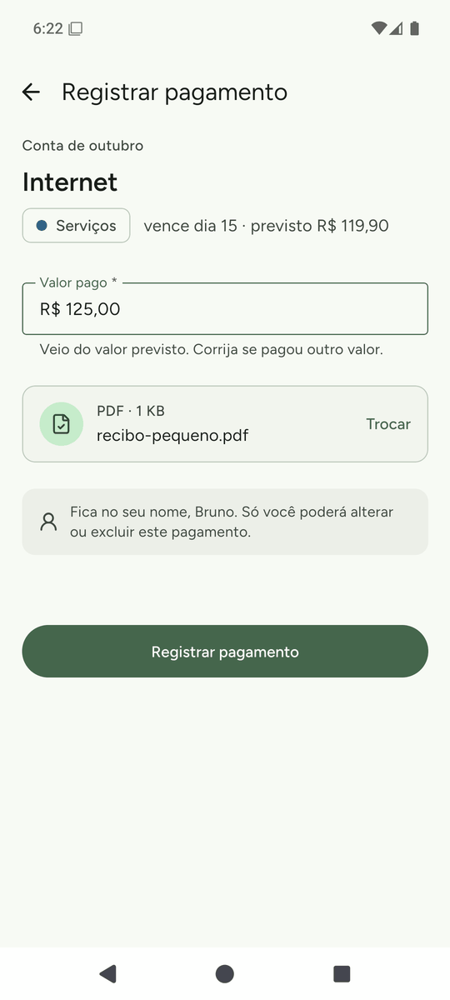<br><sub>Pagamento com comprovante</sub></td>
    <td width="25%">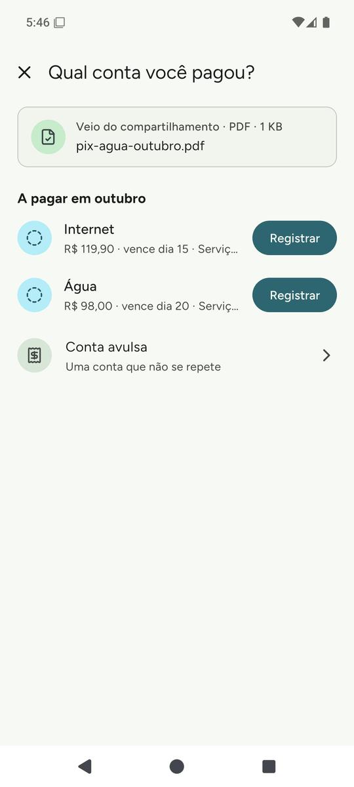<br><sub>Comprovante vindo do app do banco</sub></td>
    <td width="25%"><br><sub>Tema escuro</sub></td>
  </tr>
</table>

## Funcionalidades

- **Acesso:** login com a conta Google, restrito a uma lista de e-mails que o administrador mantém
  no próprio app. Quem sai da lista perde o acesso na hora, mesmo com o app aberto.
- **Início:** o mês em tempo real, com o que falta pagar, o que já foi pago, a divisão por tag e por
  membro, e a navegação pelos meses anteriores.
- **Contas recorrentes:** cadastradas uma vez, com valor previsto e dia de vencimento, aparecem a
  pagar todo mês. Dia 31 vira o último dia nos meses mais curtos.
- **Pagamento:** o valor vem do previsto e pode ser corrigido, com o comprovante (foto ou PDF)
  anexado. Uma conta só pode ser paga uma vez por mês, e as regras do Firestore garantem isso
  também com duas pessoas pagando ao mesmo tempo.
- **Contas avulsas:** gastos que não se repetem, com nome, valor, data, tag e comprovante.
- **Comprovantes:** a foto é comprimida no celular antes de salvar, e o PDF de uma página vira
  imagem. Abrem em tela cheia, com zoom.
- **Compartilhar do Android:** o comprovante enviado por outro app (o do banco, por exemplo) abre
  direto a escolha da conta paga, mesmo com o app fechado.
- **Autoria:** só quem registrou um lançamento pode alterá-lo ou excluí-lo.
- **Tags** com cor e nome único, e uma tag em uso não pode ser apagada.
- **Tema claro e escuro** conforme o celular, e o campo com foco nunca fica atrás do teclado.

<details>
<summary>Mais telas</summary>

<table>
  <tr>
    <td width="33%"><br><sub>Entrada</sub></td>
    <td width="33%">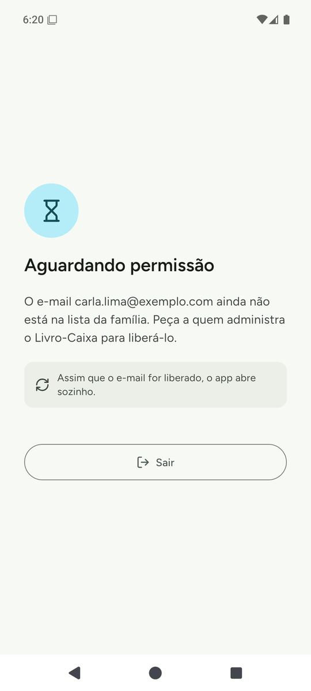<br><sub>E-mail fora da lista</sub></td>
    <td width="33%"><br><sub>A pagar e pagas</sub></td>
  </tr>
  <tr>
    <td><br><sub>Depois do pagamento</sub></td>
    <td><br><sub>Foto comprimida</sub></td>
    <td><br><sub>PDF acima do limite</sub></td>
  </tr>
  <tr>
    <td><br><sub>Meus pagamentos</sub></td>
    <td><br><sub>Mês sem lançamentos</sub></td>
    <td><br><sub>Detalhes do lançamento</sub></td>
  </tr>
  <tr>
    <td>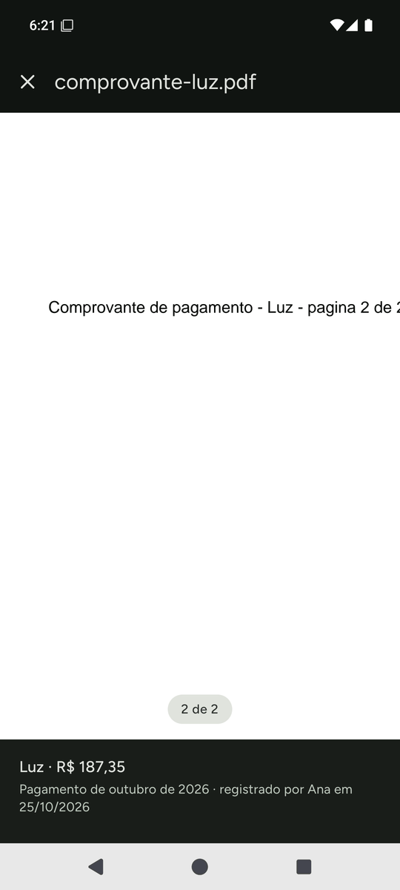<br><sub>Comprovante em tela cheia</sub></td>
    <td>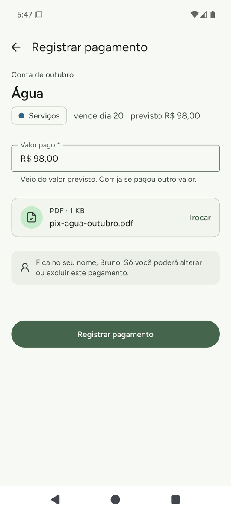<br><sub>Pagamento compartilhado</sub></td>
    <td><br><sub>Contas recorrentes</sub></td>
  </tr>
  <tr>
    <td>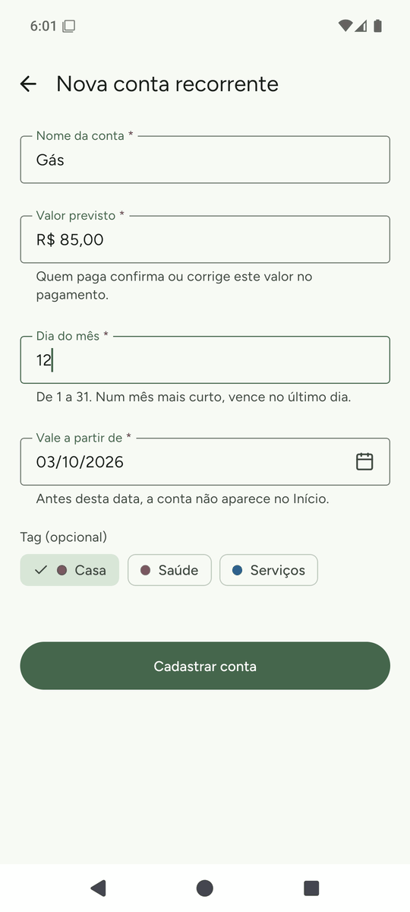<br><sub>Nova conta recorrente</sub></td>
    <td>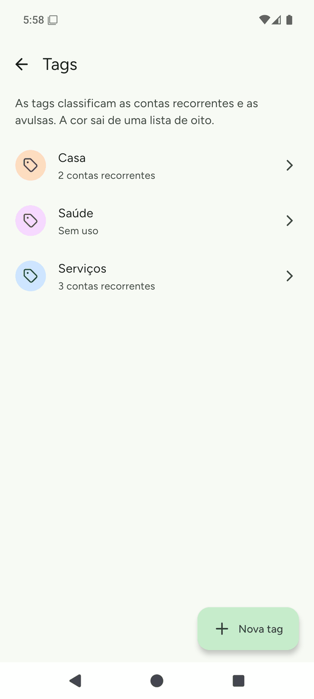<br><sub>Tags</sub></td>
    <td>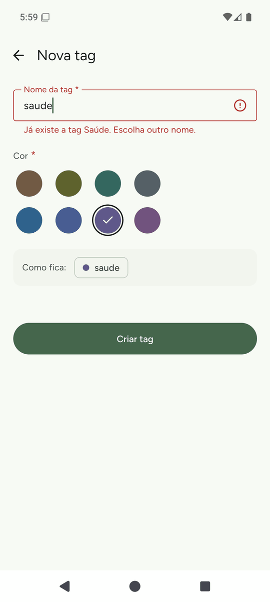<br><sub>Nome de tag repetido</sub></td>
  </tr>
  <tr>
    <td>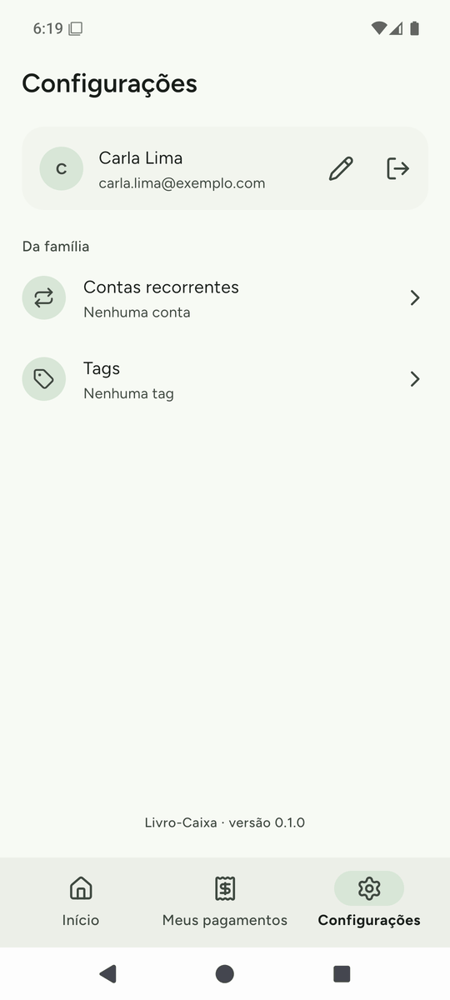<br><sub>Configurações</sub></td>
    <td>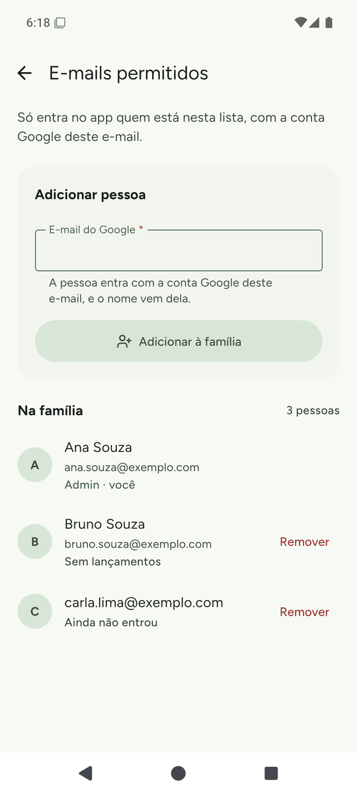<br><sub>E-mails permitidos</sub></td>
    <td>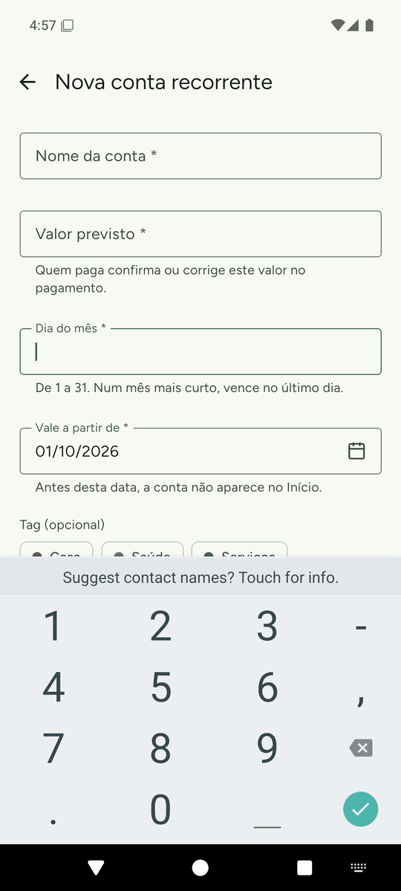<br><sub>Campo acima do teclado</sub></td>
  </tr>
</table>

</details>

## Stack

- **App:** Expo SDK 58, React Native 0.88, TypeScript, expo-router e React Compiler.
- **Back-end:** Firebase, com Auth (Google) e Firestore, pelo React Native Firebase 27 (só a API
  modular). Não há servidor nem Cloud Functions: as regras de segurança são a camada de
  autorização.
- **UI:** componentes próprios sobre os do React Native, sem biblioteca de componentes. O estilo
  usa o Unistyles 3, com os papéis de cor do Material 3 nos temas claro e escuro, e os ícones vêm
  do Lucide. O gráfico é feito com `react-native-svg`, e o zoom com Gesture Handler e Reanimated.
- **Formulários:** react-hook-form e Yup. **Estado local:** Zustand.
- **Comprovantes:** `expo-image-manipulator`, `@dariyd/react-native-pdf-page-image` (PDF → imagem
  com o `PdfRenderer` do Android), `expo-document-picker` e `expo-sharing` (receber arquivos de
  outros apps).
- **Testes:** Jest (jest-expo) com a React Native Testing Library, os emuladores do Firebase e o
  Maestro.

A escolha de cada biblioteca, com as alternativas descartadas, está em
[Plataforma e Stack](docs/05-arquitetura/01-plataforma-e-stack.md).

## Arquitetura

### Camadas do app

O `apps/mobile/src` tem quatro camadas, e cada uma só importa das que vêm depois dela:

```
app/       rotas do expo-router e os guards de acesso (Stack.Protected)
features/  uma pasta por funcionalidade: páginas, componentes e hooks dela
shared/    serviços do Firebase, componentes, hooks e utilitários usados por mais de uma feature
core/      a base: AppContainer, tema, stores, tipos e utilitários sem dependência do resto
```

O ESLint (`apps/mobile/eslint.config.mjs`) garante as fronteiras entre as camadas, os nomes de
arquivo e um export por arquivo.

### Dados

| Coleção | Conteúdo |
|---|---|
| `allowedEmails` | quem pode entrar e quem é administrador |
| `recurringBills` | as contas que se repetem todo mês |
| `entries` | os lançamentos: pagamentos de contas recorrentes e contas avulsas |
| `files` | o registro de cada comprovante (nome, tipo, tamanho, autor) |
| `fileContents` | os bytes do comprovante, lidos só ao abri-lo |
| `settings` | as tags, num documento único |

- **Valores em centavos, como inteiros**, para as somas do mês fecharem no centavo. Só a tela
  formata em reais.
- **Os comprovantes ficam no próprio Firestore**, não no Cloud Storage, que desde fevereiro de 2026
  exige o plano pago. Cada um tem no máximo 900 KB e grava `files` e `fileContents` no mesmo lote do
  lançamento, então não sobra arquivo sem lançamento nem lançamento sem arquivo.
- **As leituras são em tempo real** (`onSnapshot`), com um serviço por operação em
  `shared/services/<domínio>/`.
- **[`firebase/firestore.rules`](firebase/firestore.rules)** confere a lista de acesso, a autoria
  de cada lançamento, o pagamento único por mês e o tipo e o tamanho dos comprovantes.

O modelo completo está em
[`docs/05-arquitetura/modelo-de-dados.dbml`](docs/05-arquitetura/modelo-de-dados.dbml).

## Testes

Cada comportamento é testado na camada mais barata que consegue prová-lo:

- **Unidade** (`pnpm test:mobile`): funções, hooks e componentes isolados.
- **Página** (`pnpm test:mobile`): a tela renderizada, com a leitura em tempo real e os serviços
  mockados. Os mocks usam só cenários que o teste de contrato já rodou contra o Firebase.
- **Contrato** (`pnpm test:contract`): cada serviço, cenário por cenário, contra os emuladores do
  Firebase e com as regras de segurança.
- **Regras** (`pnpm test:rules`): o que nenhum serviço do app faz, mas um cliente com credenciais
  poderia tentar.
- **Jornadas** (`pnpm journeys:test`): fluxos do Maestro no emulador Android, contra os emuladores
  do Firebase. Servem para achar bugs, e o que acham vira teste numa das camadas acima.

Mais detalhes em [Testes](docs/05-arquitetura/03-testes.md) e
[Jornadas de Teste](docs/05-arquitetura/02-jornadas-de-teste.md).

## Rodando localmente

Pré-requisitos: Node 22.18 ou mais novo e pnpm 10. Os emuladores do Firebase (regras, contrato e
jornadas) pedem Java. O build Android pede o Android SDK e o `apps/mobile/google-services.json`,
baixado do console do Firebase e mantido fora do Git.

```sh
pnpm install                 # instala o workspace
pnpm typecheck:mobile        # tsc do app
pnpm mobile lint             # ESLint do app
pnpm test:mobile             # testes de unidade e de página
pnpm test:contract           # serviços contra os emuladores do Firebase
pnpm test:rules              # regras do Firestore
pnpm firebase:emulators      # sobe Auth e Firestore locais (UI em :4001)
pnpm android                 # build de debug no emulador Android
pnpm apk                     # APK de release assinado (precisa da keystore)
pnpm dev:docs                # portal da documentação em :4000
```

Com `EXPO_PUBLIC_USE_FIREBASE_EMULATOR=true`, o app fala com os emuladores, e não com o projeto
real. A distribuição é por APK, direto nos celulares, fora da Play Store.

## Estrutura do repositório

```
apps/mobile/       o app (Expo + React Native)
apps/docusaurus/   o portal que publica a documentação
docs/              a documentação: visão geral, negócio, funcionalidades, escopo e arquitetura
firebase/          regras do Firestore e os testes delas
journeys/          jornadas do Maestro e o stack que elas usam
design/            o design das telas (Pencil)
scripts/           build Android, APK e utilitários
```

A documentação começa em [docs/README.md](docs/README.md).
