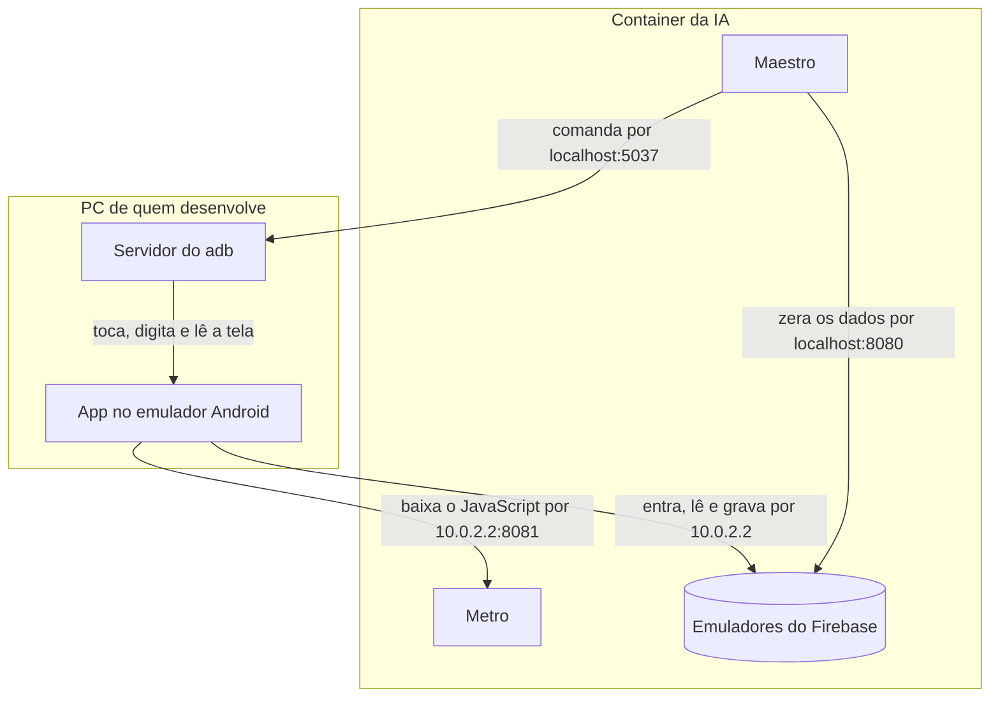
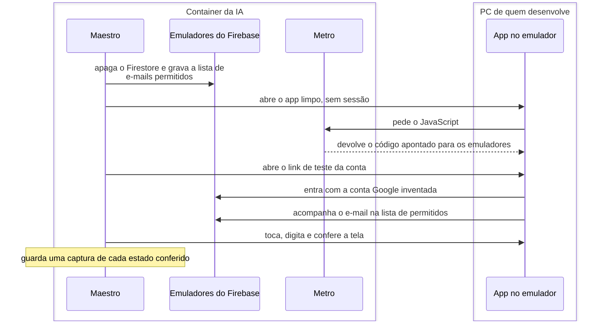

# Jornadas de Teste

**As jornadas são quem desenvolve testando o app à mão, num emulador, para achar e analisar bugs e
ver o estado do app.** O que elas acham vira um teste mais barato, e por isso são redundantes por
definição: cada verificação de uma jornada também tem um teste de página, de contrato, de unidade
ou de regras ([Testes](03-testes.md)). A ferramenta é o Maestro: a IA explora a tela pelo MCP dele
e, quando um caminho vale repetir, guarda-o como um fluxo. Os fluxos ficam em `journeys/`, na raiz
do repositório.

## As peças e onde rodam

O diagrama a seguir mostra o que roda no PC de quem desenvolve, o que roda no container em que a IA
trabalha e por qual endereço cada peça chega à outra.

- **No PC, só o emulador Android, com o app.** O container não roda um emulador, porque não tem
  aceleração de hardware.
- **No container, o Maestro, o Metro e os emuladores do Firebase** (Auth na porta 9099, Firestore
  na 8080 e Storage na 9199). O Java, o Maestro e o adb são os do PC, emprestados ao container.
- **O container divide a rede com o PC**, então o `localhost` de um é o do outro. O Maestro chega
  ao emulador Android pelo servidor do adb do PC, e o app, de dentro do emulador, chega ao PC, e
  por ele ao Metro e aos emuladores do Firebase, pelo endereço `10.0.2.2`.
- **O app é o build de debug**, que não traz o JavaScript dentro dele: a cada abertura, baixa o
  código do Metro. Mudar o código do app não pede um build novo; mudar o código nativo pede.
- **Contra os emuladores do Firebase**, com dados de teste, e não contra o projeto real.
- **O emulador é um Android 15**, com a imagem de testes do Google (`google_atd`), a mais leve que
  traz os serviços do Google que o app usa. No Android 16, a splash do app deixa a janela presa
  numa animação que nunca termina, e cada toque das jornadas passa a levar 10 s em vez de 2; no
  Android 15 isso não acontece. Quem usa o app não percebe, porque um toque de verdade não espera a
  animação.
- **A imagem de testes liga com o desenho dos apps desligado**, para os testes rodarem mais rápido:
  o app roda e as conferências do Maestro passam, mas a tela fica preta, e as capturas também. O
  `pnpm android` e o `journeys/maestro.sh` ligam o desenho de volta, e ele vale até o emulador
  reiniciar.

## O fluxo de uma jornada

Uma rodada são dois comandos, no container:

- **`pnpm journeys:stack`** (`journeys/stack.sh`) sobe a pilha: os emuladores do Firebase e o
  Metro, com `EXPO_PUBLIC_USE_FIREBASE_EMULATOR=true`. É essa variável que aponta o app para os
  emuladores, então o Metro tem de ser o da pilha, e não o de um `pnpm mobile start`. A pilha não
  sobe se uma das portas dela já estiver ocupada, e, se um dos dois cair, o outro cai junto.
- **`pnpm journeys:test`** (`journeys/maestro.sh test`) liga o desenho dos apps no emulador Android
  e desliga as animações dele, que pesam em cada troca de tela, e passa ao Maestro os fluxos de
  `journeys/flows/`. Também roda
  um fluxo só (`pnpm journeys:test <caminho do fluxo>`) ou os de uma funcionalidade
  (`pnpm journeys:test tag:auth`). Quando a IA explora o app, usa o mesmo Maestro pelo MCP
  (`journeys/maestro.sh mcp`).

Cada fluxo passa pelos mesmos passos, que o diagrama a seguir mostra: o Maestro zera os dados, abre
o app, entra numa conta e confere a tela.

1. **Zera os dados.** O script `journeys/scripts/resetData.js` apaga o Firestore do emulador e grava
   a lista de e-mails permitidos com as contas de teste. Ele fala com o emulador por HTTP, como
   administrador (`Bearer owner`), o que passa por cima das regras de segurança.
2. **Entra numa conta.** O subfluxo `journeys/subflows/signInAs.yaml` abre o app limpo, sem sessão,
   espera a tela de login, abre o link de teste da conta
   ([Como a IA entra numa conta](#como-a-ia-entra-numa-conta)) e só termina quando a entrada
   termina: daí em diante, a tela é a do perfil da conta.
3. **Confere a tela.** O fluxo toca, digita, confirma o que tem de aparecer e o que não pode
   aparecer, e tira uma captura de cada estado conferido. Um passo que muda os dados no meio do
   fluxo, como tirar um e-mail da lista com o app aberto, é outro script de `journeys/scripts/`.

**O resultado da rodada fica em `journeys/.local/captures/<data e hora>/`**, fora do Git: o
relatório JUnit (`report.xml`), com o tempo de cada fluxo, e uma pasta por fluxo, com as capturas e
o log do aparelho.

**Os fluxos rodam um depois do outro.** Cada um apaga o Firestore inteiro, e o app é uma família
por banco: dois ao mesmo tempo apagariam os dados um do outro.

## Como a IA entra numa conta

**A jornada entra por um link, `livrocaixa://test-sign-in?email=…&name=…`, com uma conta Google
inventada.** No lugar do token do Google, o app manda ao emulador do Auth um JSON com a identidade
(`sub`, `email`, `email_verified` e `name`), que ele aceita sem uma conta de verdade. O provedor
continua sendo o Google, como no login real, então as regras de acesso valem do mesmo jeito.

- **O link só funciona com o app nos emuladores.** No APK da família, ele volta para o login sem
  entrar.
- **Uma conta por perfil**, com dados de exemplo:
  - Ana Souza, `ana.souza@exemplo.com`: admin;
  - Bruno Souza, `bruno.souza@exemplo.com`: membro;
  - Carla Lima, `carla.lima@exemplo.com`: fora da lista de e-mails permitidos.
- **O nome que o app mostra vem da lista de e-mails permitidos**, e o começo de cada fluxo grava as
  contas com o nome, como o admin faria. O JSON também leva o nome, que o emulador grava na conta,
  como o Google faz.
- **O login real pelo Google fica para uma pessoa conferir**, porque o emulador não o reproduz.

## O compartilhamento de comprovantes

O Maestro comanda o aparelho inteiro, não só o app. A jornada pode fazer o que a família faz: abrir
outro app, compartilhar uma imagem ou um PDF e escolher o Livro-Caixa
([Comprovantes](../03-funcionalidades/01-principal/05-comprovantes.md)).

> 🔴 **A validar:** se a jornada chega à tela de compartilhar pelo app de arquivos do Android ou por
> um comando do adb que abre o app já com o arquivo.
