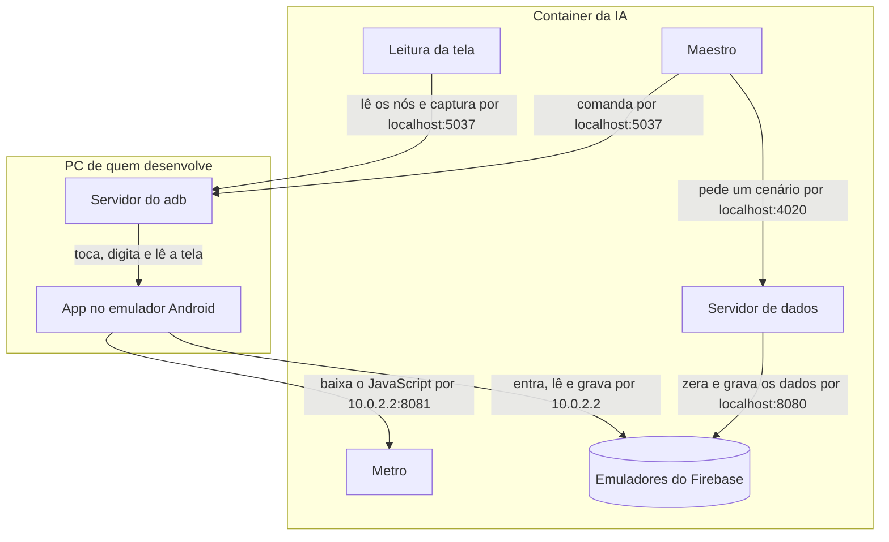
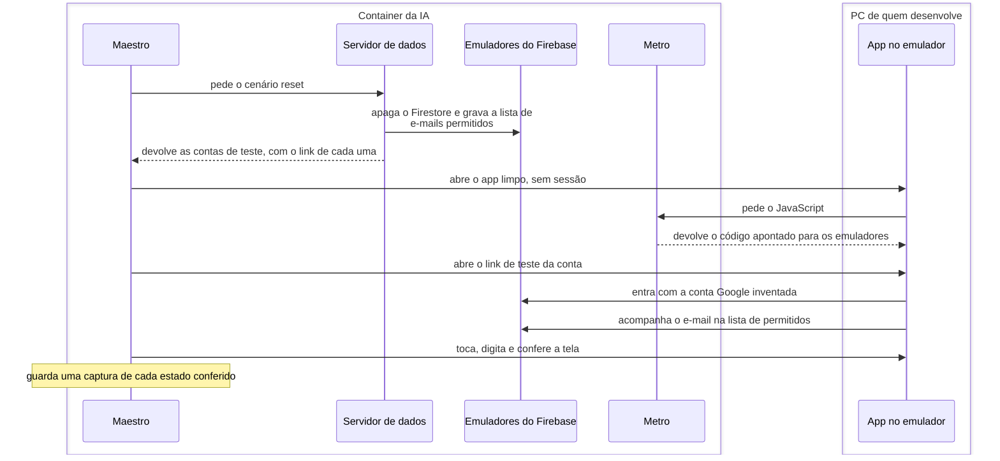

# Jornadas de Teste

**As jornadas são quem desenvolve testando o app à mão, num emulador, para achar e analisar bugs e
ver o estado do app.** O que elas acham vira um teste mais barato, e por isso são redundantes por
definição: cada verificação de uma jornada também tem um teste de página, de contrato, de unidade
ou de regras ([Testes](03-testes.md)). A ferramenta é o Maestro, pela linha de comando: a IA
explora o app com fluxos descartáveis, lê a tela pelo adb e, quando um caminho vale repetir,
guarda-o como um fluxo. Tudo fica em `journeys/`, na raiz do repositório.

## As peças e onde rodam

O diagrama a seguir mostra o que roda no PC de quem desenvolve, o que roda no container em que a IA
trabalha e por qual endereço cada peça chega à outra.



- **No PC, só o emulador Android, com o app.** O container não roda um emulador, porque não tem
  aceleração de hardware.
- **No container, o Maestro, o Metro e os emuladores do Firebase** (Auth na porta 9099, Firestore
  na 8080 e Storage na 9199). O Java, o Maestro e o adb são os do PC, emprestados ao container.
- **O servidor de dados existe só durante a rodada**, na porta 4020. O Maestro roda os scripts dos
  fluxos num motor próprio, sem Node e sem TypeScript, e só consegue falar HTTP para fora do fluxo.
  Por isso a lógica dos dados fica num servidor em TypeScript, e o fluxo só diz o nome do cenário
  que quer: zerar os dados, liberar um e-mail, tirar a marca de admin.
- **A leitura da tela** (`pnpm journeys:inspect`) e as capturas usam o adb direto, sem o Maestro.
- **O container divide a rede com o PC**, então o `localhost` de um é o do outro. O Maestro chega
  ao emulador Android pelo servidor do adb do PC, e o app, de dentro do emulador, chega ao PC, e
  por ele ao Metro e aos emuladores do Firebase, pelo endereço `10.0.2.2`.
- **O app é o build de debug**, que não traz o JavaScript dentro dele: a cada abertura, baixa o
  código do Metro. Mudar o código do app não pede um build novo; mudar o código nativo pede.
- **Contra os emuladores do Firebase**, com dados de teste, e não contra o projeto real.
- **O emulador é um Android 15**, com a imagem de testes do Google (`google_atd`), a mais leve que
  traz os serviços do Google que o app usa. No Android 16, a splash do app deixa a janela presa
  numa animação que nunca termina, e cada toque das jornadas passa a levar 10 s em vez de 2; no
  Android 15 isso não acontece. Quem usa o app não percebe, porque um toque de verdade não espera a
  animação.
- **A imagem de testes liga com o desenho dos apps desligado**, para os testes rodarem mais rápido:
  o app roda e as conferências do Maestro passam, mas a tela fica preta, e as capturas também. O
  `pnpm android` e o `pnpm journeys:test` ligam o desenho de volta, e ele vale até o emulador
  reiniciar.

## O fluxo de uma jornada

Uma rodada são dois comandos, no container:

- **`pnpm journeys:stack`** (`journeys/stack.sh`) sobe a pilha: os emuladores do Firebase e o
  Metro, com `EXPO_PUBLIC_USE_FIREBASE_EMULATOR=true`. É essa variável que aponta o app para os
  emuladores, então o Metro tem de ser o da pilha, e não o de um `pnpm mobile start`. A pilha não
  sobe se uma das portas dela já estiver ocupada, e, se um dos dois cair, o outro cai junto.
- **`pnpm journeys:test`** (`journeys/test.ts`) liga o desenho dos apps no emulador Android e
  desliga as animações dele, que pesam em cada troca de tela, apaga as rodadas antigas, liga o
  servidor de dados e passa ao Maestro os fluxos de `journeys/flows/`. Também roda um fluxo só
  (`pnpm journeys:test <caminho do fluxo>`) ou os de uma funcionalidade
  (`pnpm journeys:test tag:auth`).

Cada fluxo passa pelos mesmos passos, que o diagrama a seguir mostra: o Maestro pede os dados
zerados, abre o app, entra numa conta e confere a tela.



Todo fluxo começa pelo passo `journeys/steps/startAs.yaml`, com o perfil da conta (`admin`,
`member` ou `outsider`), que faz os dois primeiros passos:

1. **Zera os dados.** O cenário `reset` do servidor de dados apaga o Firestore do emulador e grava
   a lista de e-mails permitidos com as contas de teste. O servidor grava como dono do projeto, pela
   mesma biblioteca do teste das regras, o que passa por cima das regras de segurança.
2. **Entra numa conta.** O passo `journeys/steps/signInAs.yaml` abre o app limpo, sem sessão,
   espera a tela de login, abre o link de teste da conta
   ([Como a IA entra numa conta](#como-a-ia-entra-numa-conta)) e só termina quando a entrada
   termina: daí em diante, a tela é a do perfil da conta.
3. **Confere a tela.** O fluxo toca, digita, confirma o que tem de aparecer e o que não pode
   aparecer, e tira uma captura de cada estado conferido. Um passo que muda os dados no meio do
   fluxo, como tirar um e-mail da lista com o app aberto, pede outro cenário ao servidor de dados.

**O resultado da rodada fica em `journeys/.local/captures/<data e hora>/`**, fora do Git: o
relatório JUnit (`report.xml`), com o tempo de cada fluxo, e uma pasta por fluxo, com as capturas e
o log do aparelho. Cada rodada apaga as antigas e deixa as 5 últimas.

**Os fluxos rodam um depois do outro.** Cada um apaga o Firestore inteiro, e o app é uma família
por banco: dois ao mesmo tempo apagariam os dados um do outro.

## Como a IA explora o app

A IA usa o app pelos mesmos comandos de uma rodada, sem um servidor MCP no meio:

- **Para mexer no app**, escreve um fluxo descartável em `journeys/.local/explore/`, fora do Git,
  que começa como uma jornada (`startAs`) e vai até a tela que interessa, e o roda com
  `pnpm journeys:test`. O app fica na tela em que o fluxo parou, e o passo seguinte é outro fluxo
  curto, que continua dali.
- **Para ler a tela**, `pnpm journeys:inspect <texto>` imprime só os elementos pedidos, com o
  tamanho e a posição em dp, a unidade do design. Um botão de 48 × 48 aparece como
  `48 × 48 dp`, sem passar pela imagem.
- **Para ver a tela**, a captura do adb, só quando a cor ou a composição importam.

O MCP do Maestro, que fazia esse papel antes, saiu: cada rodada derrubava a conexão dele, e cada
resposta trazia a tela inteira para a conversa da IA.

## Onde fica cada arquivo

```text
journeys/
  stack.sh        pnpm journeys:stack: os emuladores do Firebase e o Metro
  test.ts         pnpm journeys:test: prepara o emulador, limpa as rodadas, liga o servidor de dados e roda o Maestro
  inspect.ts      pnpm journeys:inspect: os elementos da tela, em dp
  flows/          as jornadas, uma pasta por funcionalidade
  steps/          os passos de tela que vários fluxos usam: startAs e signInAs
  data/           os dados de teste: o servidor, os cenários e as contas
  .local/         fora do Git: os fluxos descartáveis e as capturas das rodadas
```

O `journeys/CLAUDE.md` diz onde entra cada coisa nova: um passo, quando vários fluxos repetem a
mesma sequência de telas; um cenário, para todo dado que um fluxo precisa.

## Como a IA entra numa conta

**A jornada entra por um link, `livrocaixa://test-sign-in?email=…&name=…`, com uma conta Google
inventada.** No lugar do token do Google, o app manda ao emulador do Auth um JSON com a identidade
(`sub`, `email`, `email_verified` e `name`), que ele aceita sem uma conta de verdade. O provedor
continua sendo o Google, como no login real, então as regras de acesso valem do mesmo jeito.

- **O link só funciona com o app nos emuladores.** No APK da família, ele volta para o login sem
  entrar.
- **Uma conta por perfil**, com dados de exemplo:
  - Ana Souza, `ana.souza@exemplo.com`: admin;
  - Bruno Souza, `bruno.souza@exemplo.com`: membro;
  - Carla Lima, `carla.lima@exemplo.com`: fora da lista de e-mails permitidos.
- **O nome que o app mostra vem da lista de e-mails permitidos**, e o começo de cada fluxo grava as
  contas com o nome, como o admin faria. O JSON também leva o nome, que o emulador grava na conta,
  como o Google faz.
- **O login real pelo Google fica para uma pessoa conferir**, porque o emulador não o reproduz.

## O compartilhamento de comprovantes

O Maestro comanda o aparelho inteiro, não só o app. A jornada pode fazer o que a família faz: abrir
outro app, compartilhar uma imagem ou um PDF e escolher o Livro-Caixa
([Comprovantes](../03-funcionalidades/01-principal/05-comprovantes.md)).

**A jornada chega à tela de compartilhar por um comando do adb, e não pelo app de arquivos**, que muda
com a versão e o idioma do Android. O cenário `shareReceipt` (`journeys/data/share.ts`) faz o que o
Android faz quando a pessoa escolhe o Livro-Caixa: o servidor de dados roda neste container, que tem o
adb, e o fluxo só pede o cenário com o nome do arquivo de `journeys/data/fixtures/`.

1. `adb push` do arquivo para `/sdcard/Download` e um `MEDIA_SCANNER_SCAN_FILE`, para a MediaStore dar
   um `_id` ao arquivo (a `content query` em `content://media/external/downloads` o mostra).
2. `am start -a android.intent.action.SEND -t <tipo> -d <endereço> --eu android.intent.extra.STREAM
   <endereço> --grant-read-uri-permission -n dev.leonardolf.livrocaixa/.MainActivity`, com o
   `content://media/external/downloads/<id>` nos dois lugares. O endereço também em `-d` porque o
   `--grant-read-uri-permission` só vale para o que está no `data` ou no `ClipData`, e o `am` não
   monta o `ClipData` do `EXTRA_STREAM`: sem o `-d` o app abre, mas falha ao ler o arquivo (`has no
   access to content://…`).
3. Os fluxos começam com o app aberto no Início: a intent chega ao app que está rodando, como quando
   a pessoa compartilha com ele já aberto.

O Livro-Caixa aparece entre os destinos: `cmd package query-activities -a
android.intent.action.SEND -t application/pdf` lista a `MainActivity` do app.